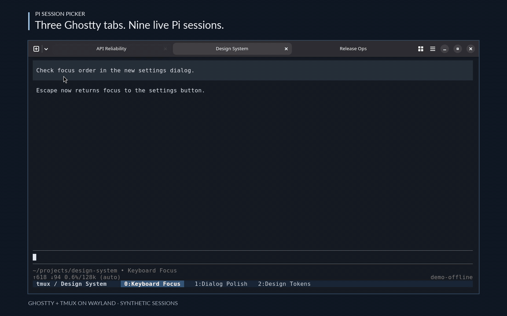

# Pi Session Picker

[](https://github.com/bline/pi-session-picker/actions/workflows/ci.yml)
[](#install)
[](LICENSE)

**Browse and switch Pi sessions without stopping the one you're in.**
Press **Left Arrow** at an empty Pi prompt, or run **`/sessions`**, to filter
sessions across projects and preview their conversations. Jump to an already
running Pi in tmux or Linux Ghostty, or open a saved session alongside it.
Without a supported terminal, you can choose to switch in place instead.

## Demo

Watch the picker switch tmux windows within **API Reliability**, then jump to
**CI Cache** in the **Release Ops** Ghostty tab. All nine Pi sessions stay open.



[Full-resolution MP4](docs/demo/pi-session-picker-layered-demo.mp4?raw=true) ·
[Still screenshot](docs/images/session-picker.png)

## Install

Requires **Pi 1.6+** and the [pi-sessions](https://github.com/psychobarge/pi-sessions)
terminal browser (`pisessions`). tmux and Ghostty are optional; Linux Ghostty
integration also needs `gdbus` and the [support described below](#focus-across-ghostty-tabs-and-tmux).

**1. Set up `pisessions`.** If `pisessions --help` lists `--select` and
`--output`, you can use that installation. Otherwise, install this pinned fork
in an isolated environment with Python 3.10+, `venv`, and Git. Picker support
is proposed upstream in [pi-sessions#8](https://github.com/psychobarge/pi-sessions/pull/8).

```sh
python3 -m venv "$HOME/.local/share/pi-session-picker/venv"
"$HOME/.local/share/pi-session-picker/venv/bin/pip" install \
  "git+https://github.com/bline/pi-sessions.git@3d7fa46b81c677bbd7f5817235180c6cfbf9b3dc"
export PI_SESSION_PICKER_BIN="$HOME/.local/share/pi-session-picker/venv/bin/pisessions"
```

Put the `export` in your shell startup file if you want it to apply to future
terminals. The extension uses `pisessions` from `PATH` when
`PI_SESSION_PICKER_BIN` is unset. The override must be an executable path,
not a command with arguments. The Pi package does not install Python software.
For a custom sessions directory, set `PI_SESSIONS_ROOT`.

**2. Install the Pi extension.** Once the package is published to npm, run:

```sh
pi install npm:pi-session-picker
```

Or install the GitHub release once the tag is available:

```sh
pi install git:github.com/bline/pi-session-picker@v0.1.0
```

To try the extension from a checkout without installing it, run
`pi -e "$PWD/extensions/session-picker.ts"` from the repository root.
Restart Pi or run `/reload` in open interactive instances after installing.

## Use the picker

Run **`/sessions`** or press **Left Arrow** at an empty Pi prompt. Press
**Enter** (or `r`) to select the highlighted session, or **Escape** (or `q`)
to cancel. Escape first closes an open side panel or clears an active filter.
In a verified tmux pane or supported Ghostty tab, Pi focuses or opens the
selected session elsewhere. Otherwise it offers to switch in place,
with **Keep current session** selected by default.

Use **`/sessions native`** to ask for an in-place switch even in tmux or
Ghostty. The prompt warns that switching closes the current session in this
Pi instance without deleting saved history. Pi handles the replacement and
any project change just as it does with `/resume`.

### Manage sessions

The picker keeps the full `pisessions` browser available, including Archive,
Restore, Delete, Rename, Export, and Live Doc.

**Before archiving, deleting, or renaming a session or project, close any
affected Pi sessions.** `pisessions` checks file modification times, not the
extension's active-session registry. An open but idle session can appear
inactive after 120 seconds by default (`PI_SESSIONS_LIVE_SECONDS`). Deletion is
permanent by default, and closing the picker does not undo management actions.
Live Doc stops updating when the picker exits and leaves the Markdown file in
place.

## Focus across Ghostty tabs and tmux

Plain **`/sessions`** uses focus mode when it verifies a tmux pane or Ghostty
tab. Use **`/sessions focus`** to require focus mode rather than being offered
an in-place switch when no backend can be verified. Selecting the currently
open session does nothing.
On the same tmux server, it selects the exact pane on the invoking client.
For other targets, it can request focus for a verified Ghostty tab, including
a tab hosting the target's tmux client. If the target's tmux session is detached,
it can open a Ghostty tab and attach to the existing pane without starting Pi
again. It refuses ambiguous or unverifiable targets rather than opening a
second copy. The compositor decides whether a requested window is raised.

If no registered Pi is using the selected file, the picker asks where to open it:

- **Ghostty in new tmux** — new Ghostty tab with its own tmux session.
- **New tmux window** — new window in the current tmux session; only shown
  from inside tmux.
- **New window in an existing tmux session…** — choose a workspace on the same
  server (inside tmux) or the default server (directly in Ghostty). Shows each
  session's window count and whether it's attached. Inside tmux, the submenu
  excludes the current session; directly in Ghostty, it appears even if there's
  only one tmux session. Escape returns to the destination menu.
- **Ghostty without tmux** — new Ghostty tab running Pi directly.

From inside tmux, your invoking client switches to the new window. From a direct
Ghostty tab, the picker brings forward the chosen session's existing tab if it
can verify the sole attached client, or attaches a new Ghostty tab if the session
is detached. It refuses to guess when multiple clients are attached or the client
cannot be verified. If you use non-default tmux sockets, invoke the picker from
inside the appropriate server to see its workspaces.

Ghostty destinations are shown only when the invoking tab can be verified.
Ghostty support requires Linux GTK, `gdbus`, and a Ghostty build with
`GHOSTTY_SURFACE_ID` and the `present-surface` and `new-tab` D-Bus actions on the
standard single-instance service (tested with Ghostty 1.4.0). It does not
switch macOS Ghostty tabs or open a new Ghostty window.

## Keep both Pi instances with tmux

From a tmux pane, use **`/sessions tmux`** and select with Enter or `r`.
Selecting the session you already have open does nothing. If another registered
Pi is using it on the same tmux server, the command brings that exact pane
forward, even in a different tmux session. It does not stop or replace either
Pi. If no registered Pi is using it, the command asks before starting
`pi --session` in a new window in the current tmux session. The `pi` executable
must be on `PATH`.

If the target is running but can't be focused, the registry can't verify it, or
multiple writable clients are viewing the source pane, the command reports the
problem instead of opening a duplicate or switching natively. Once plain
`/sessions` has chosen focus mode, a routing error does not fall back to an
in-place switch.

## Active-session registry

On Linux and macOS, Pi processes that load this extension register file-backed
sessions in `~/.cache/pi-session-picker/registry-v1/`. Records are private to
your user and contain the session ID and canonical JSONL path, the process ID
and start identity, and an `idle`, `working`, or `waiting` state. `waiting`
means Pi opened a blocking UI prompt, not that its ordinary editor is idle.
The extension updates or removes the record when Pi changes sessions or exits.

Interactive Pi instances running in a verified tmux pane also record the
socket, session, window, and pane IDs. tmux takes precedence over any outer
terminal (such as Ghostty). The outer tab, if needed, is resolved from the live
tmux client's own process, not the tmux pane's inherited environment. Pi
running directly in a verified Ghostty tab records its surface and Ghostty
process identity instead. A crashed process can leave a record behind; reads
compare both PID and start identity and distinguish stale records from ones
that cannot be verified. A verified terminal location is not required to
register a file-backed session.

**Live routing only covers Pi processes that load the extension and register
successfully.** A personal install (`pi install` without `--local`) loads the
extension in new Pi processes using that configuration. Run `/reload` or
restart already-open interactive instances to include them.

Loading the extension with `pi -e` affects only that invocation, not other
already-running or future Pi processes. New Pi processes launched by the picker
are an exception: it passes `--extension` to those launches explicitly.
In-memory sessions (such as `--no-session`) have no file to register. A missing
record cannot rule out a Pi started with packages or extensions disabled, one
using a different configuration or home directory, or one that failed to register.

Concurrent focus-mode and `/sessions tmux` launches of the same file
share a reservation until the new Pi registers or the launcher exits. If the
launcher is killed before it can clean up, the reservation can remain under
`registry-v1/launch-*`; it does not expire automatically. Only remove it after
confirming that no launch or Pi process is still using that session.

## Left Arrow shortcut

Press **Left Arrow** from Pi’s empty, focused prompt to open the same picker
as `/sessions`. It does not intercept cursor movement in a draft, active
autocomplete, or input while the agent is busy or has messages queued.

Set `PI_SESSION_PICKER_LEFT_MODE` before starting Pi to choose a behavior for
the shortcut only:

| Value | Behavior |
| --- | --- |
| `auto` (default) | Same routing as `/sessions`. |
| `focus` | Require a verified terminal, like `/sessions focus`. |
| `tmux` | Require tmux, like `/sessions tmux`. |
| `native` | Offer a confirmed in-place switch, like `/sessions native`. |
| `off` | Disable the shortcut. |

The shortcut wraps compatible custom editors without replacing their normal
key handling. Editors that do not expose focus and autocomplete state are
left alone.

## Development

Run `npm test` with Node.js 22.18 or later. No npm install is necessary.
[CI](.github/workflows/ci.yml) runs the tests (including real tmux on Linux)
and checks the npm package contents without publishing.
